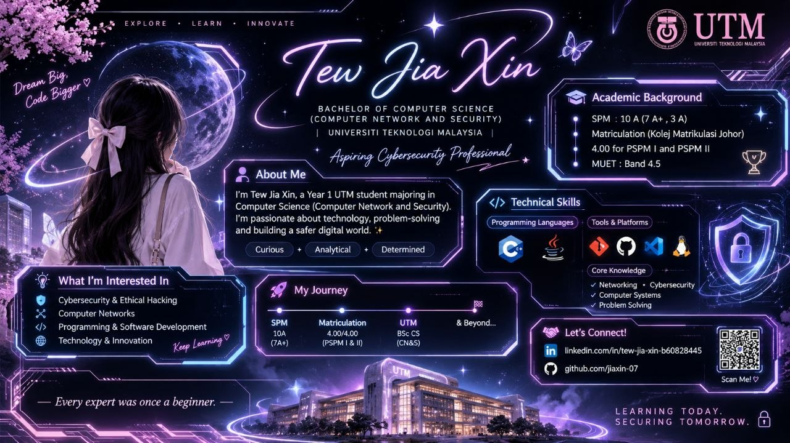

<!-- =====================================================
     TEW JIA XIN | PINK COSMIC PORTFOLIO 4.0
     Pink × Lavender × Icy Blue
     GitHub Profile README
====================================================== -->

  

  

  

  

  

✧･ﾟ: *✧･ﾟ:* &nbsp; ♡ &nbsp; *:･ﾟ✧*:･ﾟ✧

 

<!-- ABOUT ME -->

<h2 align="center">🌸 ABOUT ME</h2>

### Hi, I'm Tew Jia Xin! ♡

**Computer Science Undergraduate | Universiti Teknologi Malaysia**

Currently pursuing a Bachelor of Computer Science (Computer Networks and Security) with Honours at Universiti Teknologi Malaysia (UTM).

A curious learner who enjoys analytical thinking, solving problems and exploring how technology works behind the scenes.

I believe every challenge is an opportunity to learn something new, improve myself and grow into a better version of who I am.

 

  

✦ Stay curious. Stay creative. Keep growing. ✦

 

<!-- ACADEMIC ACHIEVEMENTS -->

<h2 align="center">🎓 ACADEMIC ACHIEVEMENTS</h2>

### Bachelor of Computer Science

**Computer Networks and Security with Honours**

Faculty of Computing · UTM

 

<table>
<tr>
<td align="center" width="50%">

# 10As

7A+ · 3A

</td>
<td align="center" width="50%">

# 4.00

Semester 1 & 2 CGPA

</td>
</tr>

<tr>
<td align="center" width="50%">

# Band 4.5

English Proficiency

</td>
<td align="center" width="50%">

# 96%

Project Class Score

</td>
</tr>
</table>

 

<!-- TECHNICAL SKILLS -->

<h2 align="center">💻 TECHNOLOGY & SKILLS</h2>

### Programming Languages

  

| Language | Knowledge |
|:---:|:---|
| C++ | Currently learning programming fundamentals |
| Java | Basic programming knowledge from previous studies |

 

### Development Tools

  

### Learning Journey

 

<!-- COMPUTER SCIENCE INTERESTS -->

<h2 align="center">🔮 COMPUTER SCIENCE INTERESTS</h2>

<table>
<tr>
<td width="50%" align="center">

### 🌐 Computer Networks

Exploring network communication, architecture, connectivity and protocols.

</td>
<td width="50%" align="center">

### 🔐 Cybersecurity

Interested in information security, network protection and digital safety.

</td>
</tr>

<tr>
<td width="50%" align="center">

### 🛡️ Ethical Hacking

Interested in understanding security weaknesses through authorized security testing.

</td>
<td width="50%" align="center">

### 🔎 Digital Forensics

Curious about digital evidence, incident investigation and cybersecurity incidents.

</td>
</tr>
</table>

 

✧ Exploring technology, one discovery at a time. ✧

 

<!-- PERSONAL INTERESTS -->

<h2 align="center">🌷 BEYOND TECHNOLOGY</h2>

| Interest | A Little About Me |
|:---:|:---|
| 🏃 Running | Staying active and challenging myself |
| 🏓 Table Tennis | Enjoying sports and friendly competition |
| 🏸 Badminton | Building energy and teamwork |
| 🎬 Content Creation | Exploring video editing and storytelling |
| 📚 Learning | Discovering new knowledge |
| 🧩 Problem Solving | Enjoying analytical thinking |

 

 

<!-- EXPERIENCES -->

<h2 align="center">🎀 LEADERSHIP & EXTRACURRICULAR EXPERIENCES</h2>

### 🚑 St John Ambulance

**5 Years of Involvement**

- Participated in school-based St John Ambulance activities.
- Gained exposure to basic first-aid related activities.
- Developed teamwork, responsibility and discipline.

 

### 🛡️ Unit Keselamatan

**School Safety Activities**

- Participated in school safety patrol activities.
- Involved in evacuation drills and safety-related activities.
- Developed awareness of safety procedures and teamwork.

 

### 🔬 STEM Month

**School Event Organising Committee**

- Participated in organising STEM Month activities.
- Experienced teamwork and event coordination.
- Developed communication and organisational skills.

 

### 🎓 UTM NALI Learning Activity

**Interview & Collaborative Learning Experience**

- Participated in an interview-based learning activity.
- Experienced active learning through direct interaction.
- Improved communication, presentation and video editing skills.
- Learned the value of active learning and knowledge sharing.

 

 

<!-- PROJECTS -->

<h2 align="center">✨ PROJECTS & ACADEMIC JOURNEY</h2>

<table>
<tr>
<td width="50%" valign="top">

### 💻 Programming Practice

Developing programming fundamentals through C++ and Java.

**Learning focus:**

- Programming logic
- Conditional statements
- Loops and repetition
- Arrays and functions
- Problem-solving

</td>

<td width="50%" valign="top">

### 🖥️ Computer Hardware Practical

Technology and Information System practical assignment.

**Activities:**

- CPU fan assembly and disassembly
- Hard disk drive assembly and disassembly
- Understanding basic hardware components

</td>
</tr>

<tr>
<td width="50%" valign="top">

### 🎤 NALI Interview Activity

Collaborative interview-based learning experience.

**Skills developed:**

- Communication
- Interview preparation
- Active learning
- Video editing
- Presentation

</td>

<td width="50%" valign="top">

### 📚 Technology & Information System

Academic coursework exploring technology and information systems.

**Focus areas:**

- Information technology
- ICT industry exposure
- Technology applications
- Collaborative academic work

</td>
</tr>
</table>

  

*More projects will be added as I continue my learning journey.*

 

<!-- SOFT SKILLS -->

<h2 align="center">💫 PERSONAL & PROFESSIONAL SKILLS</h2>

| Skill | Description |
|:---|:---|
| Communication | Expressing ideas and interacting with others |
| Teamwork | Collaborating towards shared goals |
| Adaptability | Adjusting to new environments |
| Problem Solving | Analysing situations and finding solutions |
| Time Management | Balancing academic and extracurricular activities |
| Creativity | Exploring ideas through multimedia |
| Continuous Learning | Improving knowledge and skills |

 

<!-- CAREER GOALS -->

<h2 align="center">🎯 CAREER GOALS</h2>

### Building My Future in Cybersecurity

My goal is to develop a strong foundation in computer science, computer networks and cybersecurity.

I hope to gain practical experience, strengthen my technical knowledge and explore different areas within the cybersecurity industry.

**Areas I hope to explore:**

- Network Security
- Penetration Testing
- Vulnerability Assessment
- Ethical Hacking
- Digital Forensics

I believe becoming a capable cybersecurity professional requires curiosity, continuous learning, critical thinking and responsibility.

 

**Learn Today. Secure Tomorrow. ♡**

 

<!-- GITHUB ANALYTICS -->

<h2 align="center">📊 GITHUB ANALYTICS</h2>

  

  

 

<!-- CONTACT -->

<h2 align="center">💌 CONNECT WITH ME</h2>

### Let's Connect & Share Ideas! ♡

I'm always happy to connect with fellow students, technology enthusiasts and people who enjoy learning and exploring new ideas.

 

  

📍 Malaysia

 

✧ Stay Curious · Keep Learning · Make an Impact ✧

  

<!-- END OF README -->
